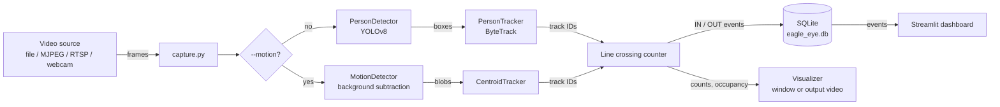

# Architecture

GitHub renders this diagram in the repository README; here it is shown as source.

## Pipeline

1. **Capture** (`src/capture.py`) opens a file, MJPEG/RTSP stream or webcam.
2. **Detect**: `PersonDetector` (YOLOv8 with confidence and size filters), or `MotionDetector` when `--motion` is set.
3. **Track**: `PersonTracker` wraps ByteTrack from the supervision library; motion mode uses `CentroidTracker` for steadier IDs.
4. **Count**: `LineCrossCounter` (or `ImprovedLineCrossCounter` in motion mode) classifies a centroid crossing the line as IN (bottom to top) or OUT (top to bottom).
5. **Persist and show**: events go to SQLite via `src/database.py`; `Visualizer` draws boxes, IDs and stats; `dashboard.py` reads the database.
